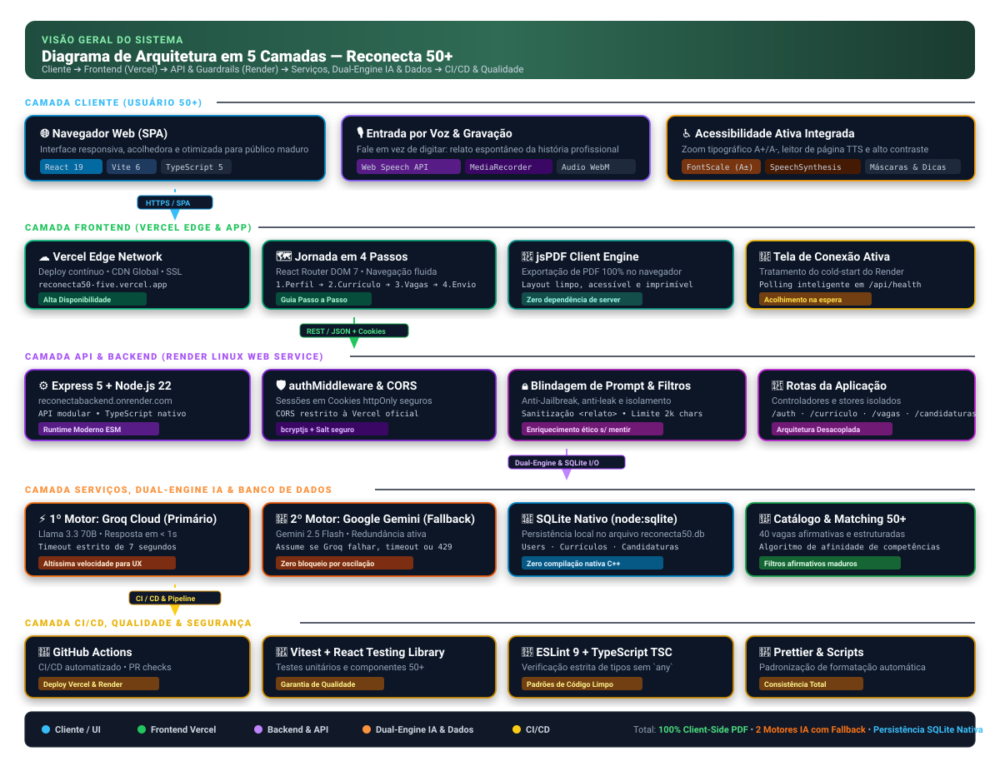
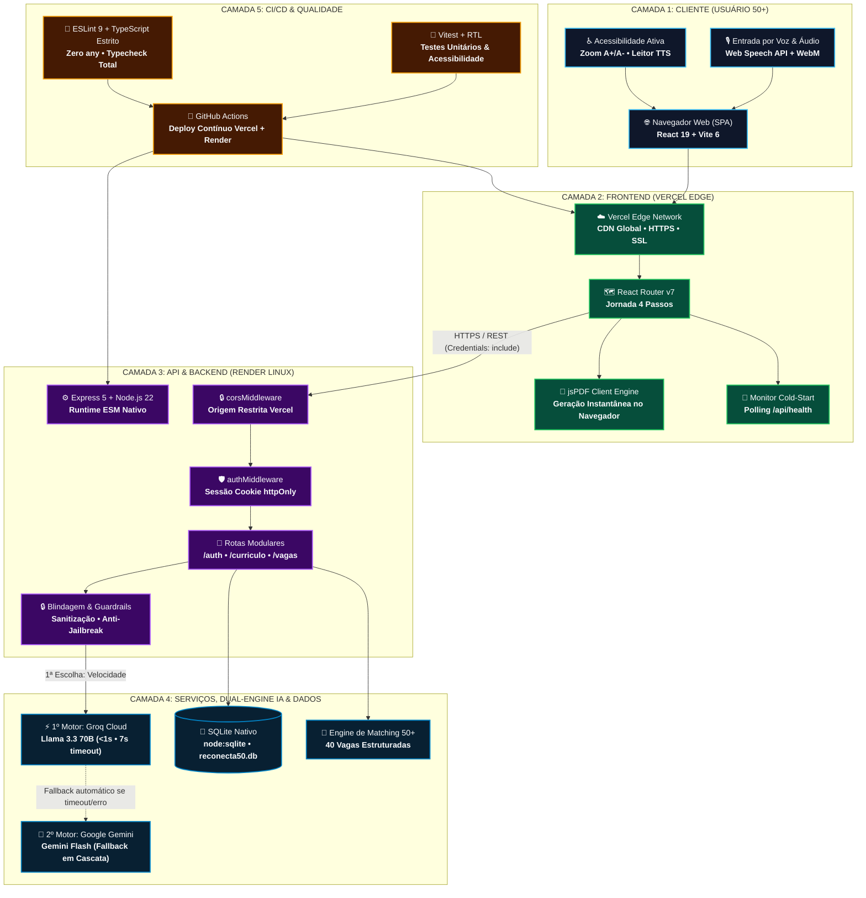
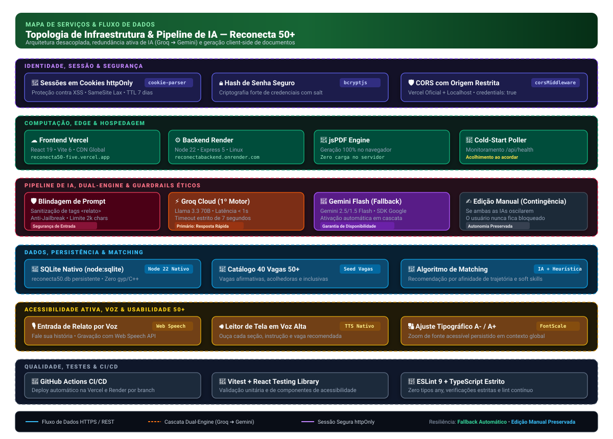

<div align="center">

# Reconecta 50+

### Uma vida de histórias. Muitas possibilidades pela frente.

**A plataforma que transforma décadas de experiência em um currículo forte e no próximo passo da carreira de quem tem 50 anos ou mais.**

[](https://reconecta50-five.vercel.app)
[](#quem-somos)


<br/>

<a href="docs/media/reconecta50-como-funciona.mp4">
  
</a>

<sub>▶️ <a href="docs/media/reconecta50-como-funciona.mp4"><b>Assista ao vídeo completo: como o Reconecta 50+ funciona (40s, com narração)</b></a></sub>

</div>

---

## 💚 Por que isso importa

Existe gente com 30 anos de estrada que não sabe por onde começar um currículo. Quem coordenou equipes inteiras escreve "eu ajudava no depósito". Quem segurou o atendimento de uma loja por duas décadas não encontra palavras para contar isso numa vaga.

**O problema não é falta de experiência. É falta de um caminho para mostrá-la.**

Os números ajudam a dimensionar a dor:

<table>
<tr>
<td align="center" width="25%"><h2>93%</h2><sub>buscavam recolocação<br/>(EY/Maturi, 2023, 4.840 profissionais 50+)</sub></td>
<td align="center" width="25%"><h2>47%</h2><sub>estavam sem emprego ou ocupação remunerada<br/>(mesma pesquisa)</sub></td>
<td align="center" width="25%"><h2>90%</h2><sub>tinham feito algum curso nos últimos anos<br/>(mesma pesquisa)</sub></td>
<td align="center" width="25%"><h2>91,8%</h2><sub>das pessoas de 50 a 59 anos usam internet<br/>(IBGE, PNAD TIC 2025)</sub></td>
</tr>
</table>

<sub>Os percentuais da EY/Maturi descrevem a base pesquisada, não toda a população 50+ brasileira. Fontes e limites estão em <a href="Mentor/Reconecta50-Dados-e-Roteiro-de-Apresentacao.md"><code>Mentor/Reconecta50-Dados-e-Roteiro-de-Apresentacao.md</code></a>.</sub>

As pessoas estão se atualizando e estão online. O que falta é a ponte entre **o que elas viveram** e **a vaga que elas merecem**. O Reconecta 50+ quer ser essa ponte.

---

## ✨ Como funciona: uma trajetória, quatro passos

<p align="center">
  
</p>

| | Passo | O que acontece |
|:-:|---|---|
| 1️⃣ | **Seus dados de contato** | Nome, telefone com WhatsApp e cidade, para que as empresas consigam falar com você. |
| 2️⃣ | **Crie seu currículo com IA** | Conte sua história falando no microfone ou digitando. A IA transforma o relato em um currículo profissional, **sem inventar nada**, e você revisa cada campo antes de salvar em PDF. |
| 3️⃣ | **Vagas recomendadas pela IA** | Com o currículo pronto, a IA analisa experiências e habilidades e indica oportunidades compatíveis, incluindo vagas afirmativas 50+. |
| 4️⃣ | **Minhas candidaturas** | Um espaço próprio para acompanhar as candidaturas enviadas. |

<table>
<tr>
<td width="33%" align="center"><br/><b>Perfil</b><br/><sub>Campos claros, com ajuda em cada um</sub></td>
<td width="33%" align="center"><br/><b>Currículo</b><br/><sub>"Conte sua história. A IA ajuda a escrever."</sub></td>
<td width="33%" align="center"><br/><b>Vagas</b><br/><sub>Indicações liberadas pelo currículo</sub></td>
</tr>
</table>

---

## 🧡 Feito para quem tem 50+, de verdade

Acessibilidade aqui não é um item da lista. É o produto.

- 🎙️ **Fale em vez de digitar.** Cada etapa do currículo aceita gravação de áudio com suporte nativo à Web Speech API.
- 🔠 **Texto do tamanho certo.** Botões `A-` e `A+` em todas as telas com zoom tipográfico proporcional.
- 🔊 **Ouvir página.** Leitor de tela por síntese de voz (TTS) nativo no topo da aplicação.
- 🧭 **Ajuda sempre à mão.** Orientações passo a passo acolhedoras que se abrem com um clique.
- 👁️ **Senha visível e máscaras de dados.** Menos erro de digitação de telefone e senha, menos frustração.
- 🔌 **Tela de conexão amigável.** Se o servidor estiver acordando do cold-start no Render, a pessoa vê o que está acontecendo em vez de uma tela quebrada.
- 📤 **Compartilhar aplicativo.** Fácil de mandar para um amigo ou filho que vai ajudar no preenchimento.

---

## 🤖 IA que valoriza, sem mentir

O coração do Reconecta 50+ é um consultor sênior de RH especializado em empregabilidade madura, com regras éticas e guardrails estritos:

- **Enriquece sem inventar.** "Eu cuidava do estoque" vira *"Gestão e controle de entradas e saídas de estoque"*. Empresas, datas e cargos nunca são inventados.
- **Valoriza soft skills 50+.** Maturidade emocional, confiabilidade, estabilidade, resiliência e escuta ativa.
- **Blindagem contra prompt injection.** Tudo que a pessoa escreve ou dita é isolado como dado bruto em tags higienizadas. Pedidos fora do escopo profissional (poemas, códigos, jailbreaks) são sumariamente ignorados.
- **Dois motores em cascata.** Groq Cloud (Llama 3.3 70B) responde primeiro em menos de 1 segundo; se demorar mais de 7 segundos ou falhar, o Google Gemini Flash assume automaticamente. Se ambos oscilarem, a edição manual continua 100% liberada.

---

## 🏗️ Arquitetura do Sistema

### 📐 Visão Geral das 5 Camadas

<p align="center">
  
</p>



---

### 🗺️ Mapa de Serviços & Pipeline de IA

<p align="center">
  
</p>

O pipeline de inteligência artificial foi desenhado para aliar **velocidade extrema**, **resiliência contra indisponibilidade** e **proteção rigorosa dos dados**:

```mermaid
sequenceDiagram
    autonumber
    actor U as Usuário 50+
    participant F as Frontend (React 19)
    participant A as API (Express 5)
    participant G as Guardrails & Sanitizer
    participant Q as Groq Cloud (Llama 3.3)
    participant M as Google Gemini (Flash)
    participant DB as SQLite Nativo

    U->>F: Fala no microfone ou digita seu histórico profissional
    F->>A: POST /api/curriculo/gerar { relato, cargo, formacao }
    A->>G: Higieniza tags, limpa caracteres de controle e limita a 2.000 chars
    
    rect rgb(20, 35, 25)
        Note over A,Q: 1º Motor: Groq Cloud (inferência em sub-segundo)
        A->>Q: Envia prompt com System Instruction de RH 50+ (timeout 7s)
        alt Groq responde com sucesso (&lt;1s)
            Q-->>A: Retorna JSON estruturado do currículo
        else Timeout (&gt;7s), Rate Limit (429) ou Erro
            Note over A,M: Fallback Automático em Cascata
            A->>M: Envia prompt para Google Gemini Flash (timeout 10s)
            M-->>A: Retorna JSON estruturado de contingência
        end
    end

    A->>A: Normaliza JSON, formaliza termos ("Ensino Médio Completo") e valida soft skills
    A-->>F: Entrega currículo pronto para conferência humana
    U->>F: Revisa campos com ajuda em tela e clica em "Salvar"
    F->>A: POST /api/curriculo/salvar
    A->>DB: Persiste no banco de dados SQLite (reconecta50.db)
    
    par Exportação Imediata
        F->>F: jsPDF renderiza PDF profissional e acessível direto no navegador
    and Recomendação de Vagas
        F->>A: POST /api/vagas/recomendadas
        A->>DB: Consulta catálogo de 40 vagas 50+
        A-->>F: Retorna vagas com percentual de compatibilidade e justificativa
    end
```

---

## 🧰 Stack Tecnológico

<table>
<tr>
<th width="50%">💻 Frontend (React 19)</th>
<th width="50%">⚙️ Backend & API (Node 22 + Express 5)</th>
</tr>
<tr>
<td valign="top">

- **Framework & Build:** React 19 • Vite 6 • TypeScript ~5.7
- **Roteamento:** React Router DOM 7.18
- **Estilização & Ícones:** CSS Modules moderno • Lucide React 0.468
- **Exportação:** jsPDF 4.2 (renderização 100% no cliente)
- **Áudio & Voz:** Web Speech API (SpeechRecognition + SpeechSynthesis) • `@fix-webm-duration/fix`
- **Acessibilidade:** Contexto global `FontScale` (A- / A+) • Leitor de tela nativo TTS • Máscaras de entrada
- **Testes & Qualidade:** Vitest 5.0 • React Testing Library 16.3 • JSDOM • ESLint 9 • Prettier

</td>
<td valign="top">

- **Runtime & Servidor:** Node.js 22+ (ESM nativo) • Express 5.3 • TypeScript 7.0
- **Banco de Dados:** SQLite nativo via `node:sqlite` (zero dependências externas e compilações C++)
- **1º Motor de IA:** Groq Cloud API (`openai/gpt-oss-120b` / `llama-3.3-70b-versatile`)
- **2º Motor de IA (Fallback):** Google Gemini SDK (`@google/genai` 2.30 • `gemini-2.5-flash`)
- **Autenticação & Sessão:** Cookies `httpOnly` • `cookie-parser` • `bcryptjs` com salt seguro
- **Segurança:** `cors` restrito à Vercel oficial • Sanitizador anti-jailbreak • Limite 64kb
- **Monitoramento:** Endpoint `/api/health` para detecção de wake-up

</td>
</tr>
</table>

---

## 📁 Estrutura do Projeto

```
Reconecta50/
├── ReconectaFrontend/               # Aplicação SPA React 19
│   ├── src/
│   │   ├── app/                     # Componente raiz App.tsx e ErrorFallback
│   │   ├── features/
│   │   │   ├── career/              # Módulo do Currículo com IA
│   │   │   │   ├── components/      # Passos 1 a 4, gravação de áudio e prévia
│   │   │   │   ├── hooks/           # useCareer e integração com o motor de IA
│   │   │   │   ├── services/        # Chamadas à API (/curriculo/gerar, /salvar)
│   │   │   │   └── types/           # Interfaces FormularioCurriculo, CurriculoEstruturado
│   │   │   ├── auth/                # Módulo de Autenticação e Sessão
│   │   │   │   ├── components/      # Formulários de login, registro e perfil
│   │   │   │   ├── services/        # authService (login, register, me, profile)
│   │   │   │   └── AuthContext.ts   # Contexto global de sessão do usuário
│   │   │   ├── jobs/                # Módulo de Oportunidades & Vagas
│   │   │   │   ├── components/      # Cards de vagas, badges 50+ e filtros
│   │   │   │   ├── services/        # jobsService (/vagas, /recomendadas, /candidaturas)
│   │   │   │   └── state/           # Contexto e reducer de candidaturas
│   │   │   └── accessibility/       # Módulo de Acessibilidade 50+
│   │   │       ├── FontScaleProvider.tsx  # Zoom proporcional A+/A-
│   │   │       └── usePageReader.ts       # Leitor de tela por síntese de voz (TTS)
│   │   ├── components/              # AccessibilityToolbar, ServerConnectingScreen, ShareButton
│   │   ├── layouts/                 # WorkspaceLayout e WorkspaceHelp
│   │   └── pages/                   # DashboardPage, ProfilePage, ResumePage, RecommendedJobsPage
│   ├── package.json
│   └── vite.config.ts
│
├── ReconectaBackend/                # API REST Express 5 + Node.js 22
│   ├── src/
│   │   ├── routes/                  # authRoutes, curriculoRoutes, vagasRoutes, candidaturasRoutes
│   │   ├── controllers/             # authController, curriculoController, vagasController
│   │   ├── middlewares/             # authMiddleware (cookies httpOnly), corsMiddleware (Vercel)
│   │   ├── services/
│   │   │   ├── geminiService.ts     # Dual-engine: Groq Cloud ➔ Fallback Google Gemini Flash
│   │   │   ├── authService.ts       # Regras de negócio de usuário e sessão
│   │   │   └── crypto.ts            # Hashing e validação bcryptjs
│   │   ├── data/
│   │   │   ├── db.ts                # Inicialização do SQLite nativo (node:sqlite)
│   │   │   ├── seed.ts              # Carga inicial com 40 vagas afirmativas 50+
│   │   │   ├── userStore.ts         # Repositório de usuários
│   │   │   └── sessionStore.ts      # Repositório de sessões ativas
│   │   └── server.ts                # Entrypoint Express, CORS e /api/health
│   ├── reconecta50.db               # Banco de dados SQLite persistente
│   └── package.json
│
├── Mentor/                          # Dados de apoio, pesquisa EY/Maturi e roteiro do pitch
├── docs/media/                      # Vídeo, gifs animados, capturas e diagramas SVG
└── CONTRIBUTING.md                  # Padrões de desenvolvimento e Pull Requests
```

---

## 🧩 Principais Módulos da Plataforma

<table>
<tr>
<td width="33%" valign="top">

### 📝 Perfil & Contato
Campos objetivos com validação de telefone, WhatsApp e cidade. Facilita o contato direto de recrutadores com o candidato.

</td>
<td width="33%" valign="top">

### 🎙️ Relato por Voz ou Texto
Opção de ditar a trajetória no microfone via Web Speech API nativa ou escrever com suporte de orientações acolhedoras.

</td>
<td width="33%" valign="top">

### 🤖 IA Consultora de RH 50+
Traduz linguagens coloquiais em termos profissionais fortes com verbos de ação assertivos, destacando soft skills maduras.

</td>
</tr>
<tr>
<td width="33%" valign="top">

### ⚡ Dual-Engine em Cascata
1º motor ultra-rápido via Groq Cloud (<1s) com fallback transparente para Google Gemini Flash em caso de timeout (7s) ou 429.

</td>
<td width="33%" valign="top">

### 🔒 Blindagem & Guardrails
Isolamento rigoroso de tags `<relato_candidato>`, corte a 2.000 caracteres e imunidade contra injeção de comandos fora de escopo.

</td>
<td width="33%" valign="top">

### ♿ Barra de Acessibilidade 50+
Zoom tipográfico dinâmico A+/A-, leitor de página em áudio TTS, botão de senha visível e interface de alto contraste.

</td>
</tr>
<tr>
<td width="33%" valign="top">

### 💼 Catálogo de 40 Vagas 50+
Base estruturada com vagas afirmativas, horários flexíveis, acolhimento etário e destaque de competências comportamentais.

</td>
<td width="33%" valign="top">

### 🎯 Recomendador por IA
Compara o perfil gerado com o catálogo de vagas e apresenta as oportunidades mais compatíveis com justificativa contextual.

</td>
<td width="33%" valign="top">

### 📄 Exportador jsPDF
Gera o PDF do currículo diretamente no navegador do usuário, com layout profissional e sem sobrecarregar o servidor.

</td>
</tr>
<tr>
<td width="33%" valign="top">

### 📬 Minhas Candidaturas
Painel centralizado para acompanhar vagas de interesse, status de envio e data de aplicação.

</td>
<td width="33%" valign="top">

### 🔌 Monitor de Cold-Start
Tela amigável que acolhe o usuário com mensagem de espera ativa enquanto o serviço no Render acorda do estado de suspensão.

</td>
<td width="33%" valign="top">

### 🛡️ Sessão Segura httpOnly
Autenticação baseada em cookies assinados e restritos ao navegador, prevenindo ataques de roubo de credenciais via XSS.

</td>
</tr>
</table>

---

## ⚖️ Decisões Técnicas de Arquitetura (Trade-offs)

| Critério | Escolha no Reconecta 50+ | Alternativa Convencional | Por que escolhemos? |
|---|---|---|---|
| **Persistência de Dados** | **SQLite nativo (`node:sqlite`)** | PostgreSQL / MySQL em nuvem | Utiliza a biblioteca oficial embutida do Node 22; zero dependência externa, zero compilação C++ e velocidade em I/O local. |
| **Motor de Inteligência Artificial** | **Dual-Engine (Groq ➔ Gemini)** | Provedor único de LLM | Groq entrega resposta em menos de 1s para ótima UX; Gemini Flash assume automaticamente se houver timeout (7s) ou cota excedida. |
| **Geração de Currículo PDF** | **Client-side com jsPDF** | Backend headless (Puppeteer) | Execução instantânea no próprio dispositivo; zero consumo de RAM no servidor gratuito e funciona mesmo com oscilações de rede. |
| **Entrada por Voz** | **Web Speech API nativa** | API paga de Speech-to-Text (Whisper) | Custo zero de processamento, sem envio de áudio para servidores terceiros, baixa latência e total compatibilidade com Chrome/Edge. |
| **Autenticação & Sessões** | **Cookies httpOnly seguros** | LocalStorage + JWT | Tokens guardados em LocalStorage são vulneráveis a roubo via scripts maliciosos (XSS). O cookie httpOnly é inacessível via JavaScript. |
| **Acessibilidade** | **Nativa no Core do Produto** | Plugins/Widgets flutuantes genéricos | Integrada nativamente ao design system e aos fluxos do usuário (zoom A+/A-, leitor TTS nativo, máscaras), sem poluição visual. |

---

### 🌐 Principais Rotas da API

| Método | Rota | Autenticação | Função |
|---|---|:---:|---|
| `GET` | `/api/health` | Pública | Healthcheck e diagnóstico dos motores Groq e Gemini |
| `POST` | `/auth/register` | Pública | Cadastro de usuário com hash bcrypt |
| `POST` | `/auth/login` | Pública | Login com emissão de cookie `httpOnly` |
| `POST` | `/auth/logout` | Sessão | Encerramento e invalidação da sessão |
| `GET` | `/auth/me` · `/auth/profile` | Sessão | Recuperação de dados do usuário logado |
| `POST` | `/api/curriculo/gerar` | Sessão | Envio do relato bruto para processamento com o Dual-Engine IA |
| `POST` | `/api/curriculo/salvar` | Sessão | Persistência do currículo revisado no banco SQLite |
| `GET` | `/api/curriculo/meu` | Sessão | Recuperação do currículo cadastrado |
| `GET` | `/api/vagas` | Pública | Listagem do catálogo de 40 vagas 50+ |
| `POST` | `/api/vagas/recomendadas` | Sessão | Cálculo de afinidade e recomendação de vagas via IA |
| `GET` | `/api/candidaturas` | Sessão | Listagem do histórico de candidaturas da pessoa |
| `POST` | `/api/candidaturas` | Sessão | Registro de nova candidatura com status inicial |

---

## 🚀 Rodando localmente

Pré-requisito: **Node.js 22+** (o backend utiliza o módulo nativo `node:sqlite`).

```bash
git clone https://github.com/hackathon-lab-ia-team1/Reconecta50.git
cd Reconecta50
```

**Backend** (porta 3001):

```bash
cd ReconectaBackend
cp .env.example .env   # preencha GROQ_API_KEY e/ou GEMINI_API_KEY
npm install
npm run dev
```

**Frontend** (porta 5173), em outro terminal:

```bash
cd ReconectaFrontend
cp .env.example .env
npm install
npm run dev
```

Abra <http://localhost:5173> e comece pelo passo 1.

**Testes e Qualidade de Código:**

```bash
cd ReconectaFrontend
npm run lint && npm run typecheck && npm test
```

---

## 🧪 Status honesto do MVP

Queremos que a banca e quem chega aqui saibam exatamente o que já existe:

- ✅ Cadastro, login e sessão com cookies seguros httpOnly
- ✅ Perfil completo com máscaras de telefone, WhatsApp e cidade
- ✅ Currículo em 4 passos com entrada de áudio, revisão humana e exportação em PDF
- ✅ Dual-Engine IA resiliente (Groq Cloud Llama 3.3 ➔ Fallback Google Gemini Flash)
- ✅ Blindagem contra prompt injection e enriquecimento ético de dados
- ✅ Barra de acessibilidade completa (zoom proporcional A+/A- e leitor de página TTS)
- ✅ Recomendações por IA sobre um **catálogo estruturado de 40 vagas demonstrativas**
- ✅ Registro e acompanhamento inicial de candidaturas
- 🔜 Integração de vagas em tempo real via parcerias com empregadores
- 🔜 Acompanhamento de feedbacks e agendamento de entrevistas

**Próxima pergunta a responder:** a pessoa consegue concluir uma candidatura? Ela recebe convite para entrevista? É contratada? O projeto prevê medir candidaturas, entrevistas e contratações em ciclos de 30, 60 e 90 dias.

---

## 🤝 Contribuindo

Fluxo de branches, padrão de commits e Pull Requests estão detalhados em [`CONTRIBUTING.md`](./CONTRIBUTING.md).

## <a id="quem-somos"></a>👥 Quem somos

**Equipe 1 do Hackathon LAB.AI 2026.** Acreditamos que experiência não tem prazo de validade e que tecnologia boa é a que abre portas para quem já tem muito a oferecer.

<div align="center">
<br/>

**Sua experiência tem valor. Vamos mostrar isso juntos.** 💚

</div>
