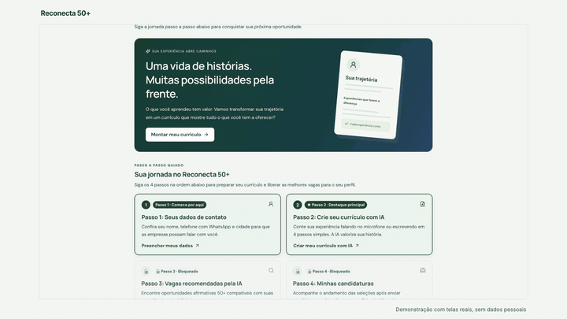
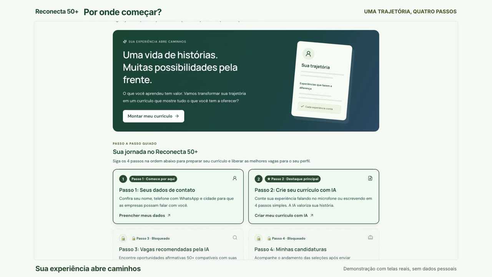
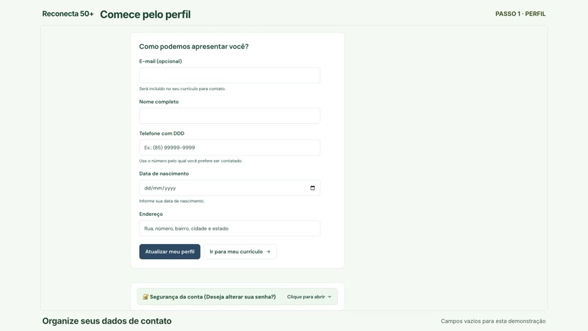
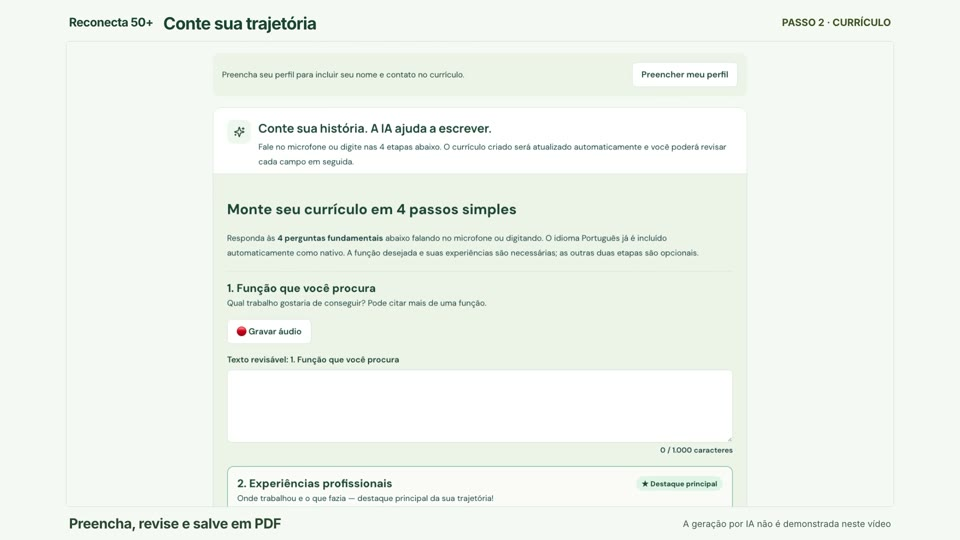
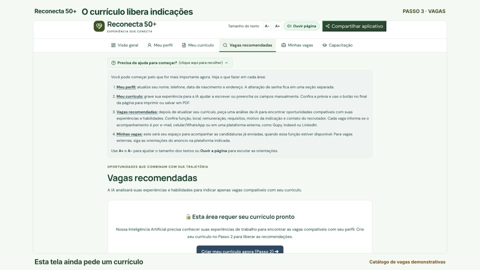
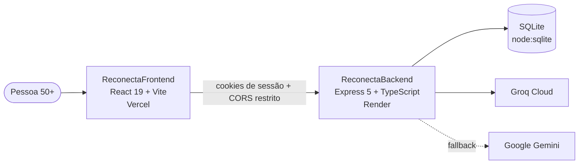

<div align="center">

# Reconecta 50+

### Uma vida de histórias. Muitas possibilidades pela frente.

**A plataforma que transforma décadas de experiência em um currículo forte e no próximo passo da carreira de quem tem 50 anos ou mais.**

[](https://reconecta50-five.vercel.app)
[](#quem-somos)


<br/>

<a href="docs/media/reconecta50-como-funciona.mp4">
  
</a>

<sub>▶️ <a href="docs/media/reconecta50-como-funciona.mp4"><b>Assista ao vídeo completo: como o Reconecta 50+ funciona (40s, com narração)</b></a></sub>

</div>

---

## 💚 Por que isso importa

Existe gente com 30 anos de estrada que não sabe por onde começar um currículo. Quem coordenou equipes inteiras escreve "eu ajudava no depósito". Quem segurou o atendimento de uma loja por duas décadas não encontra palavras para contar isso numa vaga.

**O problema não é falta de experiência. É falta de um caminho para mostrá-la.**

Os números ajudam a dimensionar a dor:

<table>
<tr>
<td align="center" width="25%"><h2>93%</h2><sub>buscavam recolocação<br/>(EY/Maturi, 2023, 4.840 profissionais 50+)</sub></td>
<td align="center" width="25%"><h2>47%</h2><sub>estavam sem emprego ou ocupação remunerada<br/>(mesma pesquisa)</sub></td>
<td align="center" width="25%"><h2>90%</h2><sub>tinham feito algum curso nos últimos anos<br/>(mesma pesquisa)</sub></td>
<td align="center" width="25%"><h2>91,8%</h2><sub>das pessoas de 50 a 59 anos usam internet<br/>(IBGE, PNAD TIC 2025)</sub></td>
</tr>
</table>

<sub>Os percentuais da EY/Maturi descrevem a base pesquisada, não toda a população 50+ brasileira. Fontes e limites estão em <a href="Mentor/Reconecta50-Dados-e-Roteiro-de-Apresentacao.md"><code>Mentor/Reconecta50-Dados-e-Roteiro-de-Apresentacao.md</code></a>.</sub>

As pessoas estão se atualizando e estão online. O que falta é a ponte entre **o que elas viveram** e **a vaga que elas merecem**. O Reconecta 50+ quer ser essa ponte.

---

## ✨ Como funciona: uma trajetória, quatro passos

<p align="center">
  
</p>

| | Passo | O que acontece |
|:-:|---|---|
| 1️⃣ | **Seus dados de contato** | Nome, telefone com WhatsApp e cidade, para que as empresas consigam falar com você. |
| 2️⃣ | **Crie seu currículo com IA** | Conte sua história falando no microfone ou digitando. A IA transforma o relato em um currículo profissional, **sem inventar nada**, e você revisa cada campo antes de salvar em PDF. |
| 3️⃣ | **Vagas recomendadas pela IA** | Com o currículo pronto, a IA analisa experiências e habilidades e indica oportunidades compatíveis, incluindo vagas afirmativas 50+. |
| 4️⃣ | **Minhas candidaturas** | Um espaço próprio para acompanhar as candidaturas enviadas. |

<table>
<tr>
<td width="33%" align="center"><br/><b>Perfil</b><br/><sub>Campos claros, com ajuda em cada um</sub></td>
<td width="33%" align="center"><br/><b>Currículo</b><br/><sub>"Conte sua história. A IA ajuda a escrever."</sub></td>
<td width="33%" align="center"><br/><b>Vagas</b><br/><sub>Indicações liberadas pelo currículo</sub></td>
</tr>
</table>

---

## 🧡 Feito para quem tem 50+, de verdade

Acessibilidade aqui não é um item da lista. É o produto.

- 🎙️ **Fale em vez de digitar.** Cada etapa do currículo aceita gravação de áudio.
- 🔠 **Texto do tamanho certo.** Botões `A-` e `A+` em todas as telas.
- 🔊 **Ouvir página.** O próprio app lê o conteúdo em voz alta.
- 🧭 **Ajuda sempre à mão.** Orientações passo a passo que se abrem com um clique.
- 👁️ **Senha visível e máscaras de dados.** Menos erro de digitação, menos frustração.
- 🔌 **Tela de conexão amigável.** Se o servidor estiver acordando, a pessoa vê o que está acontecendo em vez de uma tela quebrada.
- 📤 **Compartilhar aplicativo.** Fácil de mandar para um amigo ou um filho que vai ajudar.

---

## 🤖 IA que valoriza, sem mentir

O coração do Reconecta 50+ é um consultor de RH especializado em empregabilidade madura, com regras claras:

- **Enriquece sem inventar.** "Eu cuidava do estoque" vira *"Gestão e controle de entradas e saídas de estoque"*. Empresas e cargos nunca são inventados.
- **Valoriza soft skills 50+.** Maturidade emocional, confiabilidade, resiliência, escuta ativa.
- **Blindagem contra prompt injection.** Tudo que a pessoa escreve é tratado só como dado; pedidos fora do escopo são ignorados.
- **Dois motores em cascata.** Groq Cloud responde primeiro; se demorar ou falhar, o Google Gemini assume. Se os dois estiverem indisponíveis, a edição manual continua funcionando.

---

## 🏗️ Arquitetura



```
Reconecta50/
├── ReconectaFrontend/   # React 19, Vite, React Router, jsPDF, acessibilidade
├── ReconectaBackend/    # Express 5, autenticação, currículo com IA, vagas, candidaturas
├── Mentor/              # dados, critérios de avaliação e roteiro do pitch
├── ideias/              # brainstorming e ideias iniciais
└── docs/media/          # vídeo de demonstração e imagens deste README
```

### Principais rotas da API

| Método | Rota | Função |
|---|---|---|
| `POST` | `/auth/register` · `/auth/login` · `/auth/logout` | Cadastro e sessão |
| `GET` | `/auth/me` · `/auth/profile` | Dados da pessoa logada |
| `POST` | `/api/curriculo/gerar` | Gera o currículo com IA a partir do relato |
| `POST` | `/api/curriculo/salvar` · `GET /api/curriculo/meu` | Salva e recupera o currículo |
| `GET` | `/api/vagas` | Catálogo de vagas |
| `POST` | `/api/vagas/recomendadas` | Recomendações por IA |
| `GET`/`POST` | `/api/candidaturas` · `/api/candidaturas/preparar` | Candidaturas |

---

## 🚀 Rodando localmente

Pré-requisito: **Node.js 22+** (o backend usa o módulo nativo `node:sqlite`).

```bash
git clone https://github.com/hackathon-lab-ia-team1/Reconecta50.git
cd Reconecta50
```

**Backend** (porta 3001):

```bash
cd ReconectaBackend
cp .env.example .env   # preencha GROQ_API_KEY e/ou GEMINI_API_KEY
npm install
npm run dev
```

**Frontend** (porta 5173), em outro terminal:

```bash
cd ReconectaFrontend
cp .env.example .env
npm install
npm run dev
```

Abra <http://localhost:5173> e comece pelo passo 1.

**Qualidade:**

```bash
cd ReconectaFrontend
npm run lint && npm run typecheck && npm test
```

---

## 🧪 Status honesto do MVP

Queremos que a banca e quem chega aqui saibam exatamente o que já existe:

- ✅ Cadastro, login e sessão com cookies seguros
- ✅ Perfil, currículo em 4 passos com áudio, revisão e PDF
- ✅ Geração de currículo com IA (Groq → Gemini) e edição manual
- ✅ Recomendações por IA sobre um **catálogo de vagas demonstrativas**
- 🔜 Vagas verificadas com empregadores reais
- 🔜 Acompanhamento completo das candidaturas

**Próxima pergunta a responder:** a pessoa consegue concluir uma candidatura? Ela recebe convite para entrevista? É contratada? O piloto vai medir candidaturas, entrevistas e contratações em 30, 60 e 90 dias.

---

## 🤝 Contribuindo

Fluxo de branches, padrão de commits e Pull Requests estão em [`CONTRIBUTING.md`](./CONTRIBUTING.md).

## <a id="quem-somos"></a>👥 Quem somos

**Equipe 1 do Hackathon LAB.AI 2026.** Acreditamos que experiência não tem prazo de validade e que tecnologia boa é a que abre portas para quem já tem muito a oferecer.

<div align="center">
<br/>

**Sua experiência tem valor. Vamos mostrar isso juntos.** 💚

</div>
